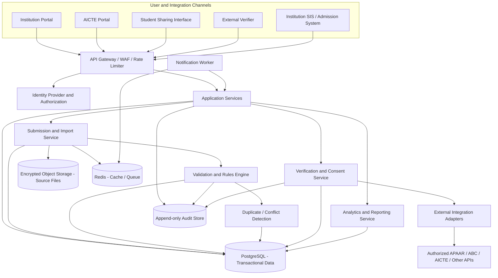

# Product Requirements Document (PRD)

# APAAR ID-Based Student Data Management and Verification Platform for AICTE-Approved Institutions

| Document field | Value |
|---|---|
| Product name | APAAR Student Data Management & Verification Platform |
| Short name | APAAR-SDMV |
| Document type | Final Product Requirements Document (PRD) |
| Version | 1.0 |
| Status | Proposed final product specification for prototype and pilot planning |
| Prepared on | 30 October 2026 |
| Product owner | AICTE / designated programme authority (to be confirmed) |
| Primary users | AICTE officials and authorized representatives of AICTE-approved institutions |
| Intended scale | Multi-institution, national-level platform; production capacity to be established through load modelling |

> **Implementation and authority note:** This PRD defines a proposed system based on the supplied problem statement. It does not imply that AICTE or the project team currently has direct access to APAAR, ABC, DigiLocker, NAD, Aadhaar, or any other government verification API. All such integrations must use officially documented interfaces and be enabled only after written authorization, credentials, security review, and applicable agreements are obtained. The prototype must use clearly labelled mock/sandbox adapters where live access is unavailable.

---

## 1. Executive Summary

AICTE needs a reliable way to collect, validate, monitor, and verify student-level enrolment information from AICTE-approved institutions. Existing submission mechanisms do not consistently provide a complete student-level view across all institution types. This limits AICTE's ability to reconcile student enrolment with approved intake, identify duplicate records, monitor special admission categories, and produce dependable regulatory and policy reports.

The proposed APAAR Student Data Management & Verification Platform (APAAR-SDMV) will provide a secure, centralized, institution-aware data platform that links student enrolment records to the student's APAAR ID. Institutions will submit student-level records through a web portal, bulk upload, or approved APIs. The platform will validate submissions, compare them against institution/programme/year approval and intake data, detect duplicate and anomalous records, maintain review workflows, and provide dashboards and reports for authorized users.

The platform will also expose a controlled verification service. Where permitted, a student may authorize a narrowly scoped disclosure of selected enrolment or academic claims to an employer or another authorized verifier. Verifications will return only the minimum necessary information and will be time-bound, auditable, and revocable where the applicable legal and policy basis permits. The platform will support signed verification receipts and QR-based verification references. It will not represent an AICTE record as a degree certificate or as an official APAAR registry response unless the relevant authority has explicitly enabled that function.

The product is intended to create a trustworthy regulatory data layer, not a replacement for APAAR, ABC, DigiLocker, NAD, or institution student information systems.

### 1.1 Product vision

Create a trusted, privacy-preserving national view of student enrolment in AICTE-approved institutions, using APAAR as the common academic identifier and providing reliable data for institutional compliance, admission monitoring, authorized verification, and evidence-based policy decisions.

### 1.2 Product promise

- One consistent student enrolment record per institution, programme, and academic period.
- A clear distinction between institution-submitted information, platform-computed validations, and independently verified information.
- Timely detection of missing identifiers, duplicates, intake exceptions, and inconsistent records.
- A traceable workflow for corrections, review, approval, and authorized disclosure.
- Institution-level and AICTE-level reporting without unnecessary exposure of student personal data.

---

## 2. Problem Statement

AICTE receives student information through different mechanisms. Some institution categories provide detailed student-level data, while many other approved institutions primarily submit aggregate enrolment figures during approval-related processes. This creates fragmented records and makes it difficult to:

1. Establish a consistent student-level view across approved institutions.
2. Reliably identify an individual student across institutional submissions.
3. Reconcile actual enrolment with approved intake and permitted supernumerary capacity.
4. Detect duplicate submissions and possible overlapping enrolments across institutions.
5. Verify that submitted APAAR identifiers are valid and, where an authorized source is available, belong to the relevant student.
6. Maintain a dependable history of admissions, corrections, transfers, withdrawals, and completions.
7. Provide controlled verification to authorized stakeholders.
8. Generate accurate institution-wise, programme-wise, category-wise, and national-level reports.

The system must replace fragmented tracking with a governed data lifecycle, rather than simply provide a form for uploading spreadsheets.

---

## 3. Product Goals and Non-Goals

### 3.1 Goals

| ID | Goal | Intended outcome |
|---|---|---|
| G-01 | Centralize student enrolment records | A consistent repository of institution-wise and student-wise records |
| G-02 | Use APAAR as the common academic identifier | Support identity-linked student records across participating institutions |
| G-03 | Improve data quality | Detect missing, malformed, inconsistent, and duplicate records before acceptance |
| G-04 | Monitor approved intake | Compare reported enrolment with the correct approved capacity and authorized exceptions |
| G-05 | Enable controlled verification | Provide an auditable, purpose-bound verification mechanism |
| G-06 | Support institutional and regulatory reporting | Produce reliable operational and policy reports |
| G-07 | Protect student information | Apply data minimization, scoped access, encryption, retention controls, and auditability |
| G-08 | Integrate with existing systems | Support approved APIs and interoperable data exchange without hard-coding external dependencies |
| G-09 | Preserve history | Maintain a traceable record of submissions, changes, validation outcomes, and decisions |

### 3.2 Non-goals

The first release will not:

- Create, issue, deactivate, or modify APAAR IDs.
- Replace the APAAR registry, Academic Bank of Credits (ABC), DigiLocker, or National Academic Depository (NAD).
- Assume direct access to Aadhaar data or store Aadhaar numbers.
- Automatically decide that a student or institution has committed fraud based only on a duplicate or anomaly signal.
- Replace an institution's Student Information System (SIS), admission system, examination system, or degree-awarding process.
- Make admission, eligibility, scholarship, accreditation, or regulatory penalty decisions without a competent authority's approved rules and review process.
- Treat an APAAR ID format check as proof of identity or proof that an identifier is authentic.
- Provide unrestricted student searches to employers, the public, or other institutions.
- Issue academic degrees or official certificates on behalf of universities or other degree-awarding bodies.
- Transfer academic credits or replace ABC workflows.

---

## 4. Product Principles

1. **APAAR is an identifier, not a password.** It must never be used as an authentication secret.
2. **Verification status must be explicit.** A syntactically valid identifier is not the same as an externally verified identity.
3. **Minimum data by default.** Collect only information needed for AICTE's defined regulatory and verification purposes.
4. **No opaque decisions.** Every validation result must include a reason, rule version, timestamp, and next action.
5. **Human review for consequential exceptions.** Possible duplicate enrolments, over-capacity admissions, and identity mismatches require an authorized review path.
6. **Separate facts from flags.** Student attributes, seat allocations, approval limits, and computed anomalies must be stored separately.
7. **Institution isolation.** An institution must not access another institution's student-level records unless a specific authorization permits it.
8. **Consent and legal authority are not interchangeable.** Mandatory regulatory processing must have a documented legal/policy basis; optional third-party disclosure must use an appropriate permission or other lawful basis.
9. **Integration by adapter.** External government services must be isolated behind replaceable integration adapters.
10. **Every important action is auditable.** Submissions, corrections, downloads, verification requests, administrative overrides, and access to sensitive records must be logged.

---

## 5. Users, Stakeholders, and Roles

### 5.1 Primary personas

| Persona | Responsibilities | Primary needs |
|---|---|---|
| Institution Administrator | Manages institution profile, users, programmes, and submission permissions | Institution onboarding, user control, submission status, reports |
| Institution Data Operator | Enters and uploads student-level enrolment data | Simple upload, validation feedback, bulk correction, downloadable error report |
| Institution Nodal Officer | Certifies or submits an institution's final data batch | Attestation, batch review, submission history, exception resolution |
| AICTE Regulation Officer | Reviews institutional submissions and exceptions | National and institution-level dashboards, queues, review tools, decision history |
| AICTE Programme/Policy Analyst | Analyses aggregated enrolment and capacity data | Reliable, filterable, exportable, anonymized or aggregated reports |
| AICTE System Administrator | Manages system configuration, roles, integration credentials, and operational controls | Secure configuration, access governance, monitoring |
| Student / Learner | Reviews their linked record and controls optional disclosures where supported | Transparency, correction route, consent management, verification sharing |
| External Verifier | Employer, regulator, or other specifically authorized organization | Verify a limited claim with a clear purpose and a trustworthy result |
| Auditor / Compliance Reviewer | Reviews data access, decisions, and system activity | Tamper-evident audit trail and exportable evidence |

### 5.2 Role-based access control

The system must apply role-based access control (RBAC), supplemented by institution, programme, academic-year, purpose, and record-level policy checks.

| Role | Access scope | Allowed actions |
|---|---|---|
| `INSTITUTION_ADMIN` | Own institution | Manage institutional users; manage permitted institution metadata; view all own institution records; submit batches; request corrections |
| `INSTITUTION_OPERATOR` | Assigned institution and optionally assigned programme | Create/edit draft records; upload batches; resolve validation errors; view submission outcomes |
| `INSTITUTION_NODAL_OFFICER` | Own institution | Review, attest, submit, and resubmit batches; respond to AICTE queries |
| `AICTE_REVIEWER` | Assigned institutions/programmes or jurisdiction | Review submissions; resolve exceptions; request corrections; record decisions |
| `AICTE_SUPERVISOR` | Authorized wider scope | Approve escalated decisions; assign cases; view authorized dashboards; configure review policies within delegated authority |
| `AICTE_ANALYST` | Aggregated or approved pseudonymized data | Generate reports and analytics; no routine access to direct identifiers unless specifically authorized |
| `SYSTEM_ADMIN` | Platform configuration | Manage technical configuration and accounts; cannot silently alter regulatory data or approve submissions solely by virtue of technical access |
| `STUDENT` | Own verified identity and linked records | View own permitted record; request correction; manage optional sharing authorizations |
| `EXTERNAL_VERIFIER` | Only a specific consented/authorized verification transaction | Verify the claims explicitly included in the transaction; no general search or bulk lookup |
| `AUDITOR` | Read-only approved scope | View audit evidence and decision histories; no edit permission |
| `INTEGRATION_CLIENT` | Specific API scopes and institution | Submit or retrieve explicitly permitted records through service-to-service authentication |

**Access-control requirements**

- All users must be linked to an organization or an explicitly approved authority.
- Institution-level users must be restricted to their own institution by default.
- External verifiers must not receive a search interface for APAAR IDs.
- Privileged roles must use multi-factor authentication (MFA).
- Role assignment, revocation, and privilege changes must be audited.
- Break-glass access, if supported, must require a reason, time limit, notification, and post-event review.
- Technical administrators must not be able to erase audit events or approve regulatory records without a separate delegated role.

---

## 6. Scope and Release Boundaries

### 6.1 MVP / hackathon prototype scope

The prototype must demonstrate a complete working flow using seeded test data and a mock APAAR verification adapter:

1. Institution login and institution-scoped dashboard.
2. AICTE login and national dashboard.
3. Institution and programme setup with academic-year-specific approved intake.
4. Single-student entry and bulk CSV upload.
5. APAAR ID format validation and mock external verification response.
6. Duplicate detection within an institution and across seeded institutions.
7. Intake reconciliation including authorized supernumerary capacity.
8. Batch review, correction, submission, and AICTE decision workflow.
9. Notifications for failed validation, returned submissions, and review outcomes.
10. Consent-scoped external verification using an expiring QR/reference link.
11. Audit trail for material actions.
12. Aggregated reports and CSV export.

### 6.2 Pilot / production scope

A pilot or production release should additionally include:

- Official institution and user onboarding/identity proofing process.
- Approved integration with AICTE's authoritative institution and approval data.
- Live APAAR/ABC/DigiLocker/NAD integration only where formally supported and authorized.
- Production-grade identity verification and integration credential management.
- Formal privacy notices, retention schedule, data-subject request workflow, and breach response process.
- Formal security testing, threat modelling, penetration testing, operational monitoring, backup and disaster recovery.
- High-availability deployment and performance testing at expected national scale.
- API versioning, partner onboarding, developer documentation, and integration support.
- Governance approval for rules, category definitions, exception handling, and certificate/QR wording.

### 6.3 Explicitly deferred

- Automated admission decisions.
- AI-based fraud determinations.
- Public student directory.
- Direct student-to-student data sharing.
- Blockchain-based identity or credential storage.
- Full academic transcript, marks, attendance, and examination record management unless specifically added to the approved scope.

---

## 7. Core Functional Requirements

Priority definitions: **P0** = required for MVP; **P1** = important for pilot; **P2** = later enhancement.

### 7.1 Institution onboarding and master data

| ID | Priority | Requirement |
|---|---|---|
| FR-ORG-01 | P0 | The platform shall maintain an authoritative institution record with AICTE institution identifier, legal name, status, institution type, and approved contact details. |
| FR-ORG-02 | P0 | The platform shall support institution campuses/locations where approval and intake differ by campus. |
| FR-ORG-03 | P0 | The platform shall maintain programmes/courses and their association with the relevant campus and awarding body. |
| FR-ORG-04 | P0 | The platform shall maintain academic-year-specific approved intake and any separately approved supernumerary capacity. |
| FR-ORG-05 | P1 | Authorized AICTE users shall be able to import or synchronize master data from an approved AICTE system. |
| FR-ORG-06 | P0 | Institutions shall be able to manage their own users within permissions delegated by AICTE. |

**Intake master-data rule:** Approved intake must be versioned and associated with institution, campus, programme, academic year, approval reference, effective date, and applicable category/seat rules. Institution users may view approved values but must not alter them. An authorized AICTE user may correct or supersede a value with a recorded reason and supporting reference.

### 7.2 Student record submission

| ID | Priority | Requirement |
|---|---|---|
| FR-STU-01 | P0 | Institution users shall be able to create a single student enrolment record. |
| FR-STU-02 | P0 | Institution users shall be able to upload a CSV template for bulk enrolment submission. |
| FR-STU-03 | P1 | The platform shall expose a versioned API for institution SIS/admission-system integration. |
| FR-STU-04 | P0 | A batch shall be processed in a staging area before it becomes an accepted submission. |
| FR-STU-05 | P0 | The system shall provide row-level validation results with machine-readable error codes and human-readable correction instructions. |
| FR-STU-06 | P0 | The system shall preserve the submitted source batch, uploader, upload time, source channel, and batch checksum. |
| FR-STU-07 | P0 | The system shall support draft, submitted, returned-for-correction, resubmitted, accepted, and rejected batch states. |
| FR-STU-08 | P1 | The system shall support incremental updates and explicit corrections without overwriting the historical record. |
| FR-STU-09 | P0 | An institution nodal officer shall attest to a batch before final submission. |
| FR-STU-10 | P1 | The system shall support signed batch acknowledgements and downloadable submission receipts. |

**Proposed minimum student/enrolment fields**

| Field | Required? | Notes |
|---|---|---|
| APAAR ID | Required where available; absence is a flagged exception | Treat as a 12-digit identifier based on current APAAR public FAQ; do not infer authenticity from format alone |
| Institution student ID / enrolment number | Required | Institution-local identifier; must not be treated as a national identifier |
| Institution ID | Required | Resolved from authenticated institution context, not trusted from arbitrary upload data |
| Campus ID | Required where institution has multiple campuses | Must map to an approved campus |
| Programme/course ID | Required | Must map to the approved programme master |
| Academic year of admission | Required | Controls intake reconciliation and cohort reporting |
| Admission date | Required | Used for enrolment lifecycle and duplicate-overlap logic |
| Current enrolment status | Required | Active, withdrawn, transferred, completed, cancelled, or pending review |
| Student name | Required only where necessary for reconciliation/verification | Minimize exposure in dashboards and reports |
| Date of birth | Optional unless an approved verification process requires it | Avoid collecting without documented necessity |
| Gender | Optional / policy-dependent | Collect only for an approved reporting purpose; include controlled values and correction process |
| Admission category | Required where applicable | Separate from nationality/residency indicators |
| Seat classification | Required | Regular approved seat, approved supernumerary seat, or other configured classification |
| NRI indicator/category | Conditional | Record according to the approved field definition and applicable policy |
| OCI status | Conditional | Store as a distinct status, not as a seat category by default |
| Foreign National (FN) status | Conditional | Store distinctly from NRI and OCI; allow policy-defined combinations only |
| Approval / exception reference | Conditional | Required for special or additional capacity where applicable |
| Record effective date | Required | Supports historical snapshots and corrections |
| Source / provenance | System-generated | Portal, CSV, API, or authorized synchronization source |

**Data minimization:** The platform must not collect Aadhaar number, passport number, parent names, personal mobile number, or other high-risk identifiers merely because they may exist in an upstream process. Any additional field requires a documented purpose, approved owner, access policy, retention rule, and lawful basis.

### 7.3 APAAR identifier validation and identity verification

| ID | Priority | Requirement |
|---|---|---|
| FR-ID-01 | P0 | The system shall validate APAAR ID presence and basic syntax, including the currently published 12-digit format. |
| FR-ID-02 | P0 | The system shall distinguish syntax validation from external identity verification. |
| FR-ID-03 | P0 | The system shall flag missing, malformed, duplicate, and unverified identifiers. |
| FR-ID-04 | P1 | The system shall call an APAAR/ABC or other authorized verification adapter when formal API access is available. |
| FR-ID-05 | P0 | The prototype shall provide a mock adapter with configurable responses and clearly label all mock results. |
| FR-ID-06 | P0 | Verification responses shall record source, request time, response time, reference ID, result, and adapter version. |
| FR-ID-07 | P1 | The system shall support retry, timeout, unavailable, and manual-review states without silently converting them into successful verification. |
| FR-ID-08 | P0 | Direct identifiers shall be masked in routine user interfaces and excluded from application logs. |

**Identifier status model**

- `MISSING`: no APAAR ID supplied.
- `MALFORMED`: value fails local syntax validation.
- `FORMAT_VALID`: local syntax checks pass; no external assertion has been made.
- `PENDING_EXTERNAL_CHECK`: waiting for an authorized verification source.
- `EXTERNALLY_CONFIRMED`: an authorized source returned an affirmative response, with source reference retained.
- `EXTERNAL_MISMATCH`: authorized source returned a mismatch or negative response.
- `EXTERNAL_UNAVAILABLE`: source could not be reached or did not provide a definitive result.
- `MANUAL_REVIEW`: case requires authorized human scrutiny.
- `CORRECTED`: institution has submitted a corrected value; revalidation is required.

The exact response vocabulary must be mapped to the official external API contract after that contract is supplied. The platform must not fabricate an `EXTERNALLY_CONFIRMED` state using a mock or local format check.

### 7.4 Duplicate and anomaly detection

| ID | Priority | Requirement |
|---|---|---|
| FR-DUP-01 | P0 | Detect duplicate APAAR IDs within the same institution and academic period. |
| FR-DUP-02 | P0 | Detect likely duplicate student records across institutions. |
| FR-DUP-03 | P0 | Identify potentially overlapping active enrolment periods. |
| FR-DUP-04 | P0 | Provide a case review workflow with evidence and institution response. |
| FR-DUP-05 | P1 | Support configured exception types such as transfer, readmission, permitted concurrent enrolment, or data correction. |
| FR-ANM-01 | P0 | Detect missing required fields, invalid programme mappings, invalid dates, and inconsistent category values. |
| FR-ANM-02 | P0 | Detect reported enrolment exceeding applicable approved capacity. |
| FR-ANM-03 | P1 | Detect unusual changes against prior-year or prior-batch data. |
| FR-ANM-04 | P1 | Provide configurable rules, thresholds, severity, and effective dates. |
| FR-ANM-05 | P0 | Display the rule and evidence behind every flag. |

**Important duplicate-handling policy:** A shared APAAR ID across records is a match signal, not proof of misconduct. The platform must examine institution, programme, academic period, admission and exit dates, enrolment status, transfer records, and configured policy exceptions. Potential conflicts must be sent to a review queue. No student record may be automatically cancelled or labelled fraudulent solely because another institution has a record with the same APAAR ID.

### 7.5 Approved-intake and seat reconciliation

The platform shall compare actual enrolment against an authoritative intake snapshot at the correct granularity:

`Institution + Campus + Programme + Academic Year + Approval Version + Seat Classification`

Capacity reconciliation must:

1. Start with the approved intake for the relevant programme and academic year.
2. Track separately approved supernumerary capacity and its authorization reference.
3. Apply category-specific rules only when those rules have been confirmed by AICTE and configured with an effective date.
4. Avoid treating NRI, OCI, and FN attributes as interchangeable with seat classifications.
5. Prevent one student's record from being counted twice in the same relevant capacity calculation.
6. Show both reported enrolment and the platform's calculated count, with exclusions and unresolved records visible.
7. Preserve the approved-intake snapshot used at the time of the calculation.
8. Flag an excess for review; do not automatically decide the regulatory consequence.

**Capacity result states:** `WITHIN_APPROVED_INTAKE`, `WITHIN_APPROVED_PLUS_AUTHORIZED_SUPERNUMERARY`, `POSSIBLE_EXCESS`, `MISSING_APPROVAL_DATA`, `PENDING_RULE_REVIEW`.

### 7.6 Review, correction, and approval workflow

| ID | Priority | Requirement |
|---|---|---|
| FR-WF-01 | P0 | Institution batches shall move through defined workflow states. |
| FR-WF-02 | P0 | AICTE reviewers shall be able to accept, return for correction, or reject a batch with a reason. |
| FR-WF-03 | P0 | Institutions shall be able to respond to each issue and resubmit corrected records. |
| FR-WF-04 | P0 | Every decision shall record actor, role, timestamp, reason, and affected record/batch. |
| FR-WF-05 | P1 | The system shall support assignment, escalation, and service-level monitoring for review cases. |
| FR-WF-06 | P1 | Material corrections to accepted records shall create a new version and trigger revalidation. |
| FR-WF-07 | P0 | Institutions shall not approve their own final regulatory verification. |

**Recommended batch states**

`DRAFT → VALIDATING → VALIDATION_FAILED / READY_FOR_ATTESTATION → SUBMITTED → UNDER_AICTE_REVIEW → RETURNED_FOR_CORRECTION / ACCEPTED / REJECTED`

The implementation must use one canonical state name in code and API contracts (for example, `UNDER_AICTE_REVIEW`); the displayed wording may be more readable.

**Recommended enrolment states**

`PENDING`, `ACTIVE`, `WITHDRAWN`, `TRANSFERRED`, `COMPLETED`, `CANCELLED`, `UNDER_REVIEW`.

Record lifecycle status and identity-verification status must remain separate fields.

### 7.7 Dashboards and reporting

**Institution dashboard**

- Approved intake by programme and academic year.
- Actual submitted enrolment.
- Active, pending, withdrawn, transferred, and completed records.
- Regular and authorized supernumerary seat counts.
- NRI, OCI, and FN counts where policy permits reporting.
- APAAR status breakdown: missing, malformed, format-valid, externally confirmed, mismatch, unavailable, manual review.
- Duplicate/anomaly flags and unresolved cases.
- Batch submission history and correction requests.

**AICTE dashboard**

- Number of approved institutions onboarded and reporting.
- Student records submitted by academic year and institution type.
- Institution/programme intake versus reported enrolment.
- Potential excess enrolment cases.
- Missing or unverified APAAR identifiers.
- Cross-institution duplicate candidates awaiting review.
- Submission timeliness and review backlog.
- Data completeness and quality trends.
- Institution and programme drill-down subject to access permissions.

**Reporting requirements**

- Filter by academic year, institution, institution type, state/region, campus, programme, category, and record status.
- Export to CSV/XLSX/PDF subject to role and field-level permissions.
- Display a generated-at timestamp, source period, filters, and data freshness note.
- Keep aggregate reports separate from student-level exports.
- Suppress or combine small groups where disclosure could identify a student, according to an approved threshold policy.
- Ensure reports use reproducible snapshots or clearly state that they reflect live data at query time.

### 7.8 Authorized student-record verification

| ID | Priority | Requirement |
|---|---|---|
| FR-VER-01 | P0 | The system shall support a limited verification response for an authorized request. |
| FR-VER-02 | P0 | A request shall identify the requesting organization, user/service, stated purpose, requested claims, and legal/consent basis. |
| FR-VER-03 | P0 | The response shall disclose only the approved minimum fields. |
| FR-VER-04 | P0 | Student-mediated external sharing shall use a clear, specific, informed authorization flow where consent is the applicable basis. |
| FR-VER-05 | P0 | Verification links/tokens shall be opaque, unguessable, signed or server-validated, time-limited, and revocable where applicable. |
| FR-VER-06 | P0 | Every verification attempt shall be logged, including denied and expired attempts. |
| FR-VER-07 | P1 | The system shall support QR codes on institution-issued documents that resolve to a controlled verification page. |
| FR-VER-08 | P1 | The system shall support cryptographically signed verification receipts/claims. |

**Verification response must distinguish:**

- Institution-submitted claim.
- AICTE repository acceptance/approval status.
- External APAAR/ABC verification result, if available.
- Institution or awarding-body credential verification, if separately available.

A successful verification of a student enrolment record does not automatically verify a degree, marksheet, or certificate. The issuing institution or authorized NAD/DigiLocker/ABC route remains authoritative for those records.

### 7.9 Certificate display and QR support

The platform shall provide an integration specification and optional QR/reference generation capability for degree-awarding bodies that wish to display the APAAR ID alongside their own student ID on certificates.

Requirements:

- The awarding body remains responsible for issuing and signing the certificate.
- The platform must not represent itself as the degree-awarding body.
- The QR code should resolve to a privacy-controlled verification endpoint using an opaque reference; it must not embed the student's full personal record.
- The printed APAAR ID should be displayed only in line with applicable AICTE, APAAR, institutional, and privacy policy.
- The system should allow the awarding body to use an approved certificate API or download a signed verification reference where formal integration is unavailable.

### 7.10 Notifications and reminders

- In-app notifications for submission, validation failure, returned batch, acceptance, rejection, and verification events.
- Email notifications where institutional contact details and delivery authorization are configured.
- Escalations for unresolved review cases after a policy-defined period.
- Configurable frequency, templates, and delivery channels.
- No sensitive student data in email subject lines or generic push notifications.
- Delivery attempts, failures, and retries must be recorded.

### 7.11 Audit and history

The audit trail shall capture at minimum:

- Authentication and privileged access events.
- Institution/user creation, modification, suspension, and role changes.
- Student-record creation, update, correction, and status change.
- Batch upload, validation, submission, return, acceptance, and rejection.
- Intake master-data changes and the approval reference used.
- APAAR/identity verification requests and responses.
- Duplicate/anomaly flags and reviewer decisions.
- Student or authorized representative consent grants, withdrawals, and scope changes.
- External verification requests, disclosures, downloads, and QR scans.
- Report exports containing student-level data.
- Administrative overrides and integration configuration changes.

Audit entries must be append-only from application workflows, protected from ordinary administrator modification, timestamped consistently, and retained according to the approved retention schedule. Sensitive values should be masked or represented by stable, non-reversible references in logs.

---

## 8. End-to-End User Journeys

### 8.1 Institution onboarding

1. AICTE or an authorized onboarding team creates/activates an institution record.
2. Institution administrator receives an invitation through a verified official channel.
3. The administrator completes account setup and MFA enrollment.
4. AICTE maps the institution's approved campuses, programmes, and relevant academic-year intake.
5. The institution assigns data operators and a nodal officer.
6. The institution can view its own master data and submission obligations.

**Success condition:** Institution can access only its own workspace and sees the correct approval/intake data.

### 8.2 Student-level data upload

1. Data operator selects academic year, campus, and programme.
2. Operator downloads the current CSV template or connects through an approved SIS API.
3. Operator uploads the batch.
4. System stores the original file, computes a checksum, and stages each row.
5. Validation engine runs field, mapping, identifier, duplicate, and capacity checks.
6. Operator receives a row-level error report and corrects issues.
7. Nodal officer reviews the batch summary and attests to it.
8. Batch is submitted to AICTE.
9. System generates a submission receipt and status timeline.

**Success condition:** No unreviewed validation error is silently accepted; every submitted row can be traced to a batch and institution.

### 8.3 AICTE review and exception resolution

1. AICTE reviewer opens the review queue.
2. Reviewer filters by institution, academic year, issue severity, and time pending.
3. Reviewer inspects the batch summary and flagged records.
4. Reviewer accepts the batch, returns it for correction, or rejects it with a reason.
5. Institution receives a notification and a list of actionable issues.
6. Corrected records are submitted as a new version, retaining prior history.
7. AICTE decision and all changes are recorded in the audit trail.

### 8.4 Duplicate enrolment investigation

1. A new enrolment matches an existing record by protected APAAR lookup token.
2. The rules engine checks date overlap, programme, institution, enrolment status, and existing transfer/exception references.
3. A potential conflict case is created with a confidence/severity indicator and evidence.
4. AICTE reviewer requests clarification from relevant institution(s) where authorized.
5. Institution provides supporting context or correction.
6. Reviewer closes the case as valid transfer, permitted concurrent enrolment, data error, unresolved, or confirmed policy breach (only if a competent authority establishes that conclusion).
7. The case outcome is retained for future review and analytics.

### 8.5 External student verification

1. Student or authorized institution initiates a verification request for a specific employer/regulator.
2. System displays the requesting party, purpose, requested data fields, and validity period.
3. Student grants the appropriate authorization, where consent is the applicable legal basis.
4. System creates an opaque one-time or short-lived QR/reference token.
5. Verifier opens the link and authenticates as required.
6. System displays the minimum allowed claims and the source/status of each claim.
7. Verification attempt and disclosed fields are logged.
8. Student can view active/recent sharing authorizations and revoke future access where applicable.

---

## 9. Business Rules and Validation Matrix

| Rule ID | Rule | Severity | Expected action |
|---|---|---|---|
| BR-001 | APAAR ID is absent where required by the approved submission policy | Warning / policy-defined blocking | Flag record; allow pending-identifier workflow only if AICTE policy permits |
| BR-002 | APAAR ID does not match current format | Error | Reject row from clean submission; show correction guidance |
| BR-003 | APAAR ID is repeated within the same submitted batch | Error | Block duplicate row(s) pending resolution |
| BR-004 | APAAR ID matches an existing record in the same institution and overlapping period | High-priority review | Create duplicate case; do not silently merge |
| BR-005 | APAAR ID matches a different institution with overlapping active enrolment | High-priority review | Create cross-institution case; do not auto-label fraud |
| BR-006 | Admission date is after exit/completion date | Error | Require correction |
| BR-007 | Programme/campus is not mapped to an active approved record for that year | Error | Require valid master-data mapping or AICTE correction |
| BR-008 | Reported count exceeds applicable approved intake and authorized supernumerary capacity | High-priority review | Flag possible excess; retain calculated evidence |
| BR-009 | Supernumerary seat is reported without an approved authorization reference where one is required | Error / review | Require evidence or correct classification |
| BR-010 | NRI, OCI, and FN attributes conflict with configured policy rules | Review | Flag for policy review; do not infer the rule |
| BR-011 | External APAAR service is unavailable | Informational / pending | Retain pending status and retry under policy |
| BR-012 | External verification returns mismatch | High-priority review | Quarantine from verified status and route to manual review |
| BR-013 | Institution submits correction to an accepted record | Review | Create a new version and re-run all applicable validations |
| BR-014 | User attempts access outside assigned institution/scope | Security event | Deny, log, and alert according to risk policy |
| BR-015 | External verification token is expired, revoked, or already consumed where single-use | Deny | Show minimal denial response and log attempt |

All business rules must be versioned with: rule ID, title, description, effective date, source/approval reference, severity, applicable institution/programme types, and owner. A rule change must not silently rewrite prior decisions; historical evaluations must retain the rule version used.

---

## 10. Data Model (Logical)

The following is a logical model. Final physical schema, indexing, and retention partitioning must be confirmed during technical design.

### 10.1 Core entities

| Entity | Key fields | Purpose |
|---|---|---|
| `Institution` | `id`, `aicte_institution_code`, `name`, `institution_type`, `status` | Institution master |
| `Campus` | `id`, `institution_id`, `campus_code`, `location`, `status` | Campus-level approval scope |
| `Programme` | `id`, `institution_id`, `campus_id`, `programme_code`, `programme_name`, `award_level` | Approved programme master |
| `ApprovalSnapshot` | `id`, `programme_id`, `academic_year`, `approval_reference`, `valid_from`, `valid_to`, `version` | Authoritative approval/intake snapshot |
| `IntakeAllocation` | `id`, `approval_snapshot_id`, `seat_classification`, `approved_count`, `authorization_reference` | Approved intake and separately authorized capacity |
| `User` | `id`, `login_identifier`, `status`, `mfa_state` | Platform user |
| `OrganizationMembership` | `user_id`, `institution_id`, `role`, `scope`, `valid_from`, `valid_to` | Institution/authority role mapping |
| `StudentIdentity` | `id`, `apaar_ciphertext`, `apaar_lookup_token`, `identifier_status`, `verification_reference` | Protected academic identity reference |
| `StudentEnrollment` | `id`, `student_identity_id`, `institution_id`, `campus_id`, `programme_id`, `student_local_id`, `academic_year`, `admission_date`, `exit_date`, `enrollment_status`, `seat_classification` | Student's enrolment at one institution/programme |
| `StudentAttribute` | `enrollment_id`, `attribute_type`, `value`, `source`, `effective_date` | Distinct attributes such as NRI, OCI, FN, and admission category |
| `SubmissionBatch` | `id`, `institution_id`, `academic_year`, `source_type`, `file_checksum`, `status`, `submitted_by` | Batch lifecycle and provenance |
| `SubmissionRow` | `id`, `batch_id`, `source_row_number`, `enrollment_id`, `row_status`, `errors` | Row-level ingestion result |
| `ValidationRun` | `id`, `batch_id`, `rule_set_version`, `started_at`, `completed_at`, `summary` | Reproducible validation execution |
| `ValidationFinding` | `id`, `validation_run_id`, `record_id`, `rule_id`, `severity`, `evidence`, `status` | Rule result and issue state |
| `IdentityVerification` | `id`, `student_identity_id`, `provider`, `provider_reference`, `result`, `checked_at`, `adapter_version` | Evidence of external identity verification |
| `DuplicateCase` | `id`, `match_group_id`, `status`, `severity`, `reviewer_id`, `resolution_code` | Human-reviewed identity/enrolment conflict |
| `ConsentGrant` | `id`, `subject_ref`, `recipient`, `purpose`, `fields_scope`, `granted_at`, `expires_at`, `revoked_at`, `notice_version` | Optional data-sharing authorization |
| `VerificationRequest` | `id`, `requester_org`, `purpose`, `requested_claims`, `token_hash`, `expires_at`, `status` | Controlled third-party verification |
| `VerificationReceipt` | `id`, `request_id`, `claims_hash`, `signature`, `issued_at`, `expires_at` | Signed proof of what was verified and when |
| `AuditEvent` | `id`, `actor`, `action`, `resource_type`, `resource_ref`, `timestamp`, `reason`, `metadata` | Append-only audit evidence |
| `Notification` | `id`, `recipient`, `event_type`, `channel`, `delivery_status`, `created_at` | Notification lifecycle |
| `IntegrationClient` | `id`, `organization_id`, `scopes`, `credential_ref`, `status` | Machine-to-machine integration identity |

### 10.2 Identity storage and duplicate lookup

- Store the APAAR ID encrypted using managed keys.
- For exact duplicate lookup, compute a keyed HMAC/token using a secret held outside the database (for example, a KMS/HSM-managed key). Do not use an unsalted plain hash of the 12-digit identifier because the identifier has a small searchable space.
- Keep raw APAAR values out of application logs, analytics events, and ordinary error traces.
- Apply field-level access controls to decrypt or display the identifier.
- Mask values in the user interface, showing only the minimum suffix required for recognition.
- Define a key-rotation and re-tokenization strategy before production.

### 10.3 Record versioning

Student enrollment records must support versioning. A correction creates a new version with `supersedes_record_id` or equivalent linkage, correction reason, actor, and effective date. Prior values remain available only to roles with a legitimate audit/review need. The platform must not silently overwrite a submitted record after it has been accepted.

### 10.4 Data-quality constraints

- Unique institutional student ID within the institution's defined namespace and applicable period.
- Foreign keys to institution, campus, programme, approval snapshot, and submission batch.
- Valid date ordering.
- Enumerated workflow states and seat classifications.
- Explicit null/unknown handling; blank and unknown must not be interpreted as false.
- Separate fields for nationality/residency attributes and seat allocation classification.
- Provenance and source timestamp for each externally sourced field.

---

## 11. Proposed API Specification

The API shown here is a proposed application contract for the new platform. It is not a claim that the same endpoints exist on APAAR or AICTE systems.

### 11.1 API conventions

- Base path: `/api/v1`
- Transport: HTTPS only.
- Authentication: OIDC/OAuth 2.0 for users; OAuth 2.0 client credentials or an approved equivalent for institution integrations.
- Authorization: RBAC plus institution/programme scope checks.
- Payloads: JSON; CSV accepted only through upload/import endpoints.
- All mutating requests should support idempotency keys where retries could create duplicates.
- Use pagination and filtering for collection endpoints.
- Return structured error codes, trace IDs, and safe human-readable messages.
- Never return full student records from an endpoint intended only for a status check.
- Version breaking contract changes through a new API version.

### 11.2 Institution and master-data endpoints

| Method | Endpoint | Purpose |
|---|---|---|
| `GET` | `/institutions/me` | Retrieve authenticated institution context |
| `GET` | `/institutions/me/programmes` | List authorized programmes and campuses |
| `GET` | `/institutions/me/intake?academicYear=YYYY-YY` | Retrieve approved intake snapshot |
| `GET` | `/institutions/me/users` | List institution users (admin only) |
| `POST` | `/institutions/me/users/invitations` | Invite an institution user |

### 11.3 Student and batch endpoints

| Method | Endpoint | Purpose |
|---|---|---|
| `POST` | `/enrollments` | Create a single draft enrolment |
| `GET` | `/enrollments/{enrollmentId}` | Retrieve an authorized enrolment record |
| `PATCH` | `/enrollments/{enrollmentId}` | Correct an editable draft or submit a correction request |
| `POST` | `/submission-batches` | Create a batch/import session |
| `POST` | `/submission-batches/{batchId}/file` | Upload CSV file |
| `POST` | `/submission-batches/{batchId}/validate` | Start validation |
| `GET` | `/submission-batches/{batchId}/results` | Retrieve row-level outcomes |
| `POST` | `/submission-batches/{batchId}/attest` | Nodal-officer attestation |
| `POST` | `/submission-batches/{batchId}/submit` | Submit batch to AICTE |
| `GET` | `/submission-batches` | List institution batches |

### 11.4 Validation and case-management endpoints

| Method | Endpoint | Purpose |
|---|---|---|
| `GET` | `/validation-runs/{runId}` | Retrieve validation summary |
| `GET` | `/validation-findings` | Filter findings by batch, institution, severity, and status |
| `GET` | `/duplicate-cases` | List authorized duplicate review cases |
| `GET` | `/duplicate-cases/{caseId}` | View evidence and case history |
| `POST` | `/duplicate-cases/{caseId}/resolve` | Record an authorized resolution |
| `POST` | `/review-cases/{caseId}/request-information` | Request institution clarification |
| `POST` | `/review-cases/{caseId}/decision` | Record accept/return/reject/close decision |

### 11.5 Verification endpoints

| Method | Endpoint | Purpose |
|---|---|---|
| `POST` | `/verification-requests` | Create a purpose-bound verification request |
| `GET` | `/verification-requests/{requestId}` | Retrieve request state |
| `POST` | `/verification-requests/{requestId}/authorize` | Record relevant student authorization |
| `POST` | `/verification-requests/{requestId}/issue-link` | Create an expiring verification reference |
| `GET` | `/public/verify/{opaqueToken}` | Resolve only the claims allowed by the token/policy |
| `POST` | `/verification-requests/{requestId}/revoke` | Revoke future access where applicable |

### 11.6 Reporting endpoints

| Method | Endpoint | Purpose |
|---|---|---|
| `GET` | `/analytics/overview` | Dashboard metrics for authorized scope |
| `GET` | `/reports/enrolment` | Enrolment by programme/institution/year |
| `GET` | `/reports/intake-reconciliation` | Approved intake versus enrolment |
| `GET` | `/reports/data-quality` | Completeness, identifier, and validation metrics |
| `POST` | `/reports/exports` | Create controlled report export |

### 11.7 Example API payloads

**Create an enrolment draft**

```json
{
  "institutionStudentId": "CSE26-001",
  "campusId": "campus_001",
  "programmeId": "prog_cse_be",
  "academicYear": "2026-27",
  "admissionDate": "2026-08-10",
  "apaarId": "123456789012",
  "enrollmentStatus": "ACTIVE",
  "seatClassification": "APPROVED_REGULAR",
  "admissionCategory": "GENERAL",
  "attributes": {
    "nriStatus": false,
    "ociStatus": false,
    "foreignNationalStatus": false
  }
}
```

> Example data only. The sample identifier is not a real person’s identifier and must not be accepted as a valid APAAR record merely because it has 12 digits. Category values and field definitions must be aligned with AICTE's approved schema before implementation.

**Validation response**

```json
{
  "batchId": "batch_01JTEST",
  "status": "VALIDATION_COMPLETED",
  "summary": {
    "totalRows": 100,
    "validRows": 92,
    "rowsWithWarnings": 5,
    "rowsWithErrors": 3
  },
  "findings": [
    {
      "rowNumber": 14,
      "ruleId": "BR-005",
      "severity": "HIGH",
      "code": "POSSIBLE_CROSS_INSTITUTION_OVERLAP",
      "message": "A potentially overlapping enrolment requires authorized review.",
      "action": "REVIEW_CASE_CREATED"
    }
  ]
}
```

### 11.8 External integration adapter contract

Create provider interfaces such as:

- `ApaarVerificationProvider.verify(identifier, purpose, consentContext)`
- `AicteMasterDataProvider.getInstitutionApproval(institutionId, academicYear)`
- `InstitutionSISProvider.importEnrollments(institutionId, batch)`
- `DigiLockerProvider.requestDocumentAccess(subject, scopes)` (only if an approved flow and API are provided)
- `NotificationProvider.send(recipient, template, payload)`

Each adapter must support `SUCCESS`, `NOT_FOUND`, `MISMATCH`, `UNAVAILABLE`, `TIMEOUT`, `UNAUTHORIZED`, and `UNSUPPORTED` outcomes as appropriate. The platform must never treat `UNAVAILABLE` or `UNSUPPORTED` as successful verification.

---

## 12. Technical Architecture

### 12.1 Recommended logical architecture



### 12.2 Suggested implementation stack

This is a recommended implementation stack, not a requirement imposed by AICTE.

| Layer | Suggested technology | Reason |
|---|---|---|
| Web frontend | React or Next.js + TypeScript | Role-specific portal and reusable UI components |
| Backend API | Python FastAPI | Clear API contracts, validation libraries, rapid integration development |
| Database | PostgreSQL | Strong relational integrity, transactions, constraints, and reporting queries |
| Cache / queue | Redis | Rate limiting, job coordination, temporary state, queue backend |
| Background processing | Celery or equivalent worker framework | Bulk import, verification retries, report generation, notifications |
| Object storage | S3-compatible private bucket / MinIO for prototype | Store source files and generated reports outside the relational database |
| Authentication | OIDC-compatible identity provider | MFA, lifecycle management, federated login where approved |
| Document processing | Python CSV/PDF tooling; OCR only where required | Process uploaded evidence without making OCR a source of truth |
| Observability | OpenTelemetry-compatible tracing, metrics, structured logs | Diagnose jobs, integrations, and API performance |
| Deployment | Containers; managed cloud or approved Government infrastructure | Repeatable deployment and environment isolation |

### 12.3 Service boundaries

The first implementation can be a modular monolith with clear internal boundaries. Microservices are not required for the prototype. Separate services only when deployment scale, security isolation, team ownership, or availability requirements justify the operational cost.

Recommended modules:

1. Identity and access management.
2. Institution and approval master data.
3. Student enrolment and batch ingestion.
4. Validation and rule evaluation.
5. Duplicate case management.
6. Consent and external verification.
7. Reporting and analytics.
8. Notifications.
9. Audit and compliance.
10. External integration adapters.

### 12.4 Data flow and transaction boundaries

- Upload is first stored in private object storage and registered as a batch.
- The batch is parsed into staging rows.
- Each row is validated without mutating accepted enrolment records.
- Valid rows are committed only after the institution attestation and required submission step.
- AICTE review decisions are committed transactionally with the audit event and status transition.
- External API calls must not be made while holding long-running database transactions.
- Integration calls use timeouts, retries with backoff, idempotency keys, and a dead-letter queue for repeatedly failing jobs.
- Reports should use indexed queries or pre-aggregated tables/materialized views where scale requires it.

---

## 13. Security, Privacy, and Compliance Requirements

The product handles student personal data and must be designed as a high-sensitivity administrative system.

### 13.1 Privacy-by-design

- Define the purpose for every collected field.
- Avoid collecting Aadhaar number or any unrelated identity data.
- Separate mandatory regulatory processing from optional third-party data sharing.
- Present clear privacy information explaining the data collected, purposes, recipients, retention, correction route, and contact point.
- Capture authorization/consent with the specific recipient, purpose, fields, notice version, time, and expiry where consent is the applicable basis.
- Support withdrawal of optional sharing authorization and stop future access where technically and legally applicable.
- Provide a workflow for correction requests and applicable data-principal rights.
- Use aggregated or de-identified data for policy analytics wherever student-level detail is unnecessary.
- Do not expose sensitive records in URLs, logs, analytics tags, or email notifications.

### 13.2 Consent and lawful processing

The platform must not assume that consent is the sole legal basis for every AICTE regulatory operation. AICTE and participating institutions must document the applicable legal authority and their respective data-fiduciary/processor roles before production deployment. For optional employer or other external verification, use a specific, transparent, purpose-bound authorization or another legally approved basis. Consent must not be bundled into unrelated terms or used to authorize unlimited future disclosure.

Where minors or individuals requiring a lawful guardian's involvement may be represented, the system must support an approved guardian/representative flow. The exact age threshold, exemptions, evidence, and verification method must be configured only after legal and policy review.

### 13.3 Application and infrastructure security

- TLS 1.2+ (prefer TLS 1.3 where supported) for all network traffic.
- Encryption at rest for databases, object storage, backups, and exports.
- Managed secrets; no credentials or encryption keys in source code or container images.
- MFA for AICTE, institutional administrators, reviewers, and privileged accounts.
- OIDC/OAuth 2.0 or approved identity federation.
- RBAC with institution and resource-level authorization on every request.
- Short-lived access tokens and secure refresh-token handling.
- Rate limits and abuse detection on authentication, upload, and public verification endpoints.
- Malware scanning and file-type/size validation for uploaded documents.
- CSRF protection where cookie-based authentication is used; secure cookie flags.
- Input validation, parameterized queries, output encoding, and standard OWASP application controls.
- Dependency and container image scanning.
- Centralized security logging and alerting.
- Regular key rotation and documented key recovery/rotation procedures.
- Backups encrypted and restoration tested.

### 13.4 Sensitive identifier protection

- APAAR ID must not be used for authentication.
- Store raw APAAR IDs encrypted and expose them only to roles with a defined need.
- Use keyed HMAC tokens for exact matching; do not rely on ordinary SHA hashes for a low-entropy identifier.
- Mask identifiers in ordinary dashboards and CSV exports.
- Restrict decryption permission to a dedicated service or narrowly scoped role.
- Use pseudonymous internal IDs in analytics and application logs.

### 13.5 Audit and accountability

- Append-only audit events for sensitive operations.
- Time synchronization across application services.
- Audit logs protected from ordinary operator alteration/deletion.
- Monitoring for unusual bulk access, repeated failed verification, cross-institution access attempts, and report exports.
- Periodic access recertification for privileged users and integration clients.
- Documented incident response, escalation, containment, and breach notification responsibilities.

### 13.6 Regulatory alignment note

Design and launch reviews must consider the Digital Personal Data Protection Act, 2023 and the Digital Personal Data Protection Rules, 2025, along with applicable education-sector and government security requirements. The 2025 Rules provide for phased commencement; the project legal owner must confirm which provisions are in force at the date of deployment and obtain current legal advice. This PRD is a product/engineering specification, not legal advice.

---

## 14. Non-Functional Requirements (NFRs)

The following are proposed targets for design and acceptance testing. They must be validated against AICTE's expected national data volume, hosting environment, and service-level commitments before production approval.

| ID | Area | Proposed requirement / target |
|---|---|---|
| NFR-01 | Availability | Target 99.5% monthly availability for pilot; production target to be agreed, with 99.9% as an initial planning objective |
| NFR-02 | API latency | p95 under 500 ms for standard database-backed reads under expected load, excluding external provider latency and large exports |
| NFR-03 | Dashboard performance | Common dashboard views load within 3 seconds at agreed test dataset and concurrency |
| NFR-04 | Bulk ingestion | Process a 10,000-row test batch within 5 minutes on agreed reference infrastructure, excluding external verification latency |
| NFR-05 | Scalability | Support horizontal scaling of stateless API and worker components |
| NFR-06 | Data integrity | No duplicate committed batch processing when the same idempotency key is retried |
| NFR-07 | Security | Complete threat model, dependency scan, and independent penetration test before production |
| NFR-08 | Privacy | Field-level purpose, access, retention, and export rules documented for all personal data fields |
| NFR-09 | Auditability | 100% of defined critical actions create an audit event |
| NFR-10 | Recovery | Pilot RPO/RTO targets to be agreed; initial planning target RPO <= 15 minutes and RTO <= 4 hours for production architecture |
| NFR-11 | Accessibility | Target WCAG 2.1 AA for key user journeys, subject to applicable government accessibility standards |
| NFR-12 | Interoperability | Versioned REST APIs, documented CSV schema, and stable institution/programme identifiers |
| NFR-13 | Observability | Correlation ID across API, batch, worker, and external verification flows |
| NFR-14 | Localization | English for MVP; architecture must support additional Indian languages in later releases |
| NFR-15 | Data portability | Authorized institution can export its own records and submission history in approved formats |

---

## 15. UX and Interface Requirements

### 15.1 Design approach

The interface must prioritize clarity, accuracy, and efficient administrative work. It should avoid dense forms, unexplained status labels, and visually alarming warnings for unconfirmed matches.

### 15.2 Core screens

**Shared screens**

- Sign-in, MFA, account recovery.
- User profile and security settings.
- Notifications.
- Help, data dictionary, and support route.

**Institution portal**

1. Institution dashboard.
2. Programme and intake overview.
3. Student record list with filters.
4. Single student enrolment form.
5. CSV upload wizard with template download.
6. Batch validation results and row-level corrections.
7. Nodal officer attestation and submission confirmation.
8. Review/return messages from AICTE.
9. Duplicate/anomaly case response page.
10. Submission history and exports.

**AICTE portal**

1. National overview dashboard.
2. Institution directory and institution profile.
3. Programme/intake master-data management.
4. Submission and review queue.
5. Batch detail and validation evidence.
6. Duplicate case investigation.
7. Intake reconciliation.
8. Analytics and report builder.
9. User, role, and integration management.
10. Audit and activity search.

**Student and external verification experience**

1. Verification request details and purpose.
2. Data fields to be shared.
3. Authorization/consent action and confirmation.
4. Active/recent sharing history.
5. QR/reference verification result page.
6. Minimal result view for the external verifier.

### 15.3 Status design

Every status shown to a user must have:

- A plain-language label.
- A concise explanation.
- A timestamp.
- The responsible party or next action.
- A reason or validation code where relevant.

Do not use a single green “Verified” badge to represent several different checks. For example, display `APAAR format valid`, `APAAR externally confirmed`, `Institution record accepted`, and `Credential verified` as distinct claims.

---

## 16. Analytics and Key Performance Indicators

### 16.1 Operational KPIs

| KPI | Definition | Target-setting approach |
|---|---|---|
| Institution onboarding rate | Active onboarded institutions / institutions in approved scope | Set target after baseline and onboarding plan |
| Submission coverage | Institutions submitting student-level data / institutions required to submit | Target by reporting cycle |
| Record completeness | Records with all required fields / submitted records | Establish baseline; improve each cycle |
| APAAR format pass rate | Records passing local format validation / records with an APAAR value | Monitor quality, not identity authenticity |
| External verification success rate | Definitive successful external checks / completed checks | Interpret with provider availability and coverage |
| Duplicate review rate | Duplicate candidates per 1,000 submissions | Monitor, not minimize blindly; quality of detection matters |
| Duplicate resolution time | Median time from case creation to resolution | Set SLA by severity |
| Intake exception rate | Programmes with potential excess / programmes reporting | Review with approved capacity context |
| Batch processing time | Time from upload to completed validation | Compare against NFR target |
| AICTE review turnaround | Time from batch submission to decision | Set SLA by review type |
| Correction rate | Records returned for correction / records submitted | Segment by institution and error type |
| Verification turnaround | Time from external request to final response | Set target after integration design |

### 16.2 Policy analytics

- Enrolment trends by academic year, programme, institution type, region, and seat classification.
- Approved intake versus actual enrolment.
- Institution-level reporting completeness.
- Student mobility and transfer trends, using appropriately minimized data.
- Distribution of APAAR verification states.
- Category-wise enrolment where definitions and access are approved.
- Historical corrections and data quality trends.

### 16.3 Analytics safeguards

- Use aggregate or pseudonymized data by default.
- Keep direct identity access separate from analytical access.
- Record report filters and exports.
- Apply suppression thresholds for small cohorts where required.
- Do not rank or penalize institutions solely on unreviewed anomaly counts.

---

## 17. Testing and Quality Assurance

### 17.1 Functional test scenarios

| Test ID | Scenario | Expected result |
|---|---|---|
| T-001 | Submit a valid single enrolment with a 12-digit APAAR-shaped value | Format status is `FORMAT_VALID`; no claim of external verification |
| T-002 | Submit a missing APAAR ID | Record is flagged; pending-ID policy is applied |
| T-003 | Submit an APAAR ID with letters or incorrect length | Row fails format validation with clear error |
| T-004 | Upload the same student row twice in one batch | Duplicate row is detected and not double-counted |
| T-005 | Upload an APAAR ID already present in the same institution | Duplicate case or correction workflow is created |
| T-006 | Upload an APAAR ID found at another institution with overlapping active dates | Potential conflict is created; no automatic fraud label or deletion |
| T-007 | Upload a transfer with non-overlapping admission/exit dates | Transfer context can be reviewed and resolved without a false positive being auto-confirmed |
| T-008 | Submit enrolment within approved programme intake | Capacity status reflects within approved intake |
| T-009 | Submit enrolment exceeding approved intake | Possible excess is flagged with calculation evidence |
| T-010 | Submit separately authorized supernumerary seat with valid approval reference | Capacity engine applies configured approved exception |
| T-011 | Submit supernumerary seat without required reference | Row/case is flagged according to policy |
| T-012 | Change NRI/OCI/FN values independently | Values remain distinct and do not change seat classification automatically |
| T-013 | External APAAR adapter returns unavailable | Status stays pending/unavailable; never becomes confirmed |
| T-014 | Mock adapter returns confirmed | UI explicitly labels the result as mock/sandbox in prototype mode |
| T-015 | Institution A requests Institution B's student record | Access is denied and audited |
| T-016 | Nodal officer attests and submits a batch | Batch enters AICTE review and receipt is generated |
| T-017 | AICTE returns a batch for correction | Institution sees row-level issue and can resubmit a new version |
| T-018 | AICTE accepts a batch | Accepted state and decision evidence are recorded |
| T-019 | External verifier opens expired token | Disclosure is denied and attempt is logged |
| T-020 | Student revokes optional sharing | Future access is denied where revocation applies |
| T-021 | Generate a report as an analyst | Only permitted aggregate/pseudonymized fields appear |
| T-022 | Export student-level data as an unauthorized role | Export is blocked |
| T-023 | Modify an accepted student record | New version and audit event are created; old version is retained per policy |
| T-024 | Attempt an unauthorized role change or privileged action | Request is denied and security event is captured |

### 17.2 Security testing

- Authentication, authorization, and privilege escalation tests.
- Institution tenant-isolation tests.
- API object-level authorization tests.
- Injection, XSS, CSRF, SSRF, and file-upload attack tests.
- Token expiry, replay, revocation, and brute-force tests.
- Secret exposure and log redaction tests.
- Encryption and key-management review.
- Audit-log integrity and access tests.
- Dependency, container, and infrastructure scans.
- Penetration testing before production launch.

### 17.3 Performance testing

Test at minimum:

- 1,000-row and 10,000-row CSV imports.
- Concurrent institution users submitting batches.
- Large AICTE dashboard filters.
- High-volume duplicate lookup.
- External-provider timeout and retry conditions.
- Concurrent report exports.
- Queue backlog recovery after worker restart.

### 17.4 Data migration and reconciliation tests

- Validate mapping from representative institution CSV/SIS formats.
- Compare aggregate student counts before and after import.
- Reconcile programme/campus identifiers with AICTE master records.
- Check that rerunning the same import does not inflate counts.
- Test correction, transfer, withdrawal, and re-admission histories.

---

## 18. Delivery Plan and Milestones

The schedule below is an indicative engineering plan. It is not an AICTE delivery commitment.

### Phase 0 — Discovery and governance

**Deliverables**
- Confirm institutional user roles and approval authority.
- Obtain the authoritative institution/programme/intake data structure.
- Confirm the required student field dictionary.
- Confirm seat classification and special-category rules.
- Confirm legal basis, consent responsibilities, retention, and access policy.
- Request APAAR/ABC/DigiLocker and AICTE integration documentation and sandbox access.

**Exit criteria:** No unresolved ambiguity in the required MVP fields, intake granularity, and batch acceptance workflow.

### Phase 1 — Foundation

**Deliverables**
- Repository and deployment environments.
- Authentication, MFA-ready roles, and institution scoping.
- Institution, campus, programme, and intake master data.
- Database schema, audit framework, and object storage.
- Base portal layout and API conventions.

**Exit criteria:** Institution users can authenticate and see only their own institution's approved programme/intake data.

### Phase 2 — Data ingestion and validation

**Deliverables**
- Single student entry.
- CSV template, upload wizard, and staging pipeline.
- APAAR format validator and mock provider.
- Duplicate detection and basic intake reconciliation.
- Row-level error report and resubmission workflow.

**Exit criteria:** End-to-end upload, validation, correction, attestation, and submission work using seeded test institutions.

### Phase 3 — AICTE workflow and dashboards

**Deliverables**
- AICTE review queue.
- Accept/return/reject decisions.
- Institution and AICTE dashboards.
- Anomaly case management.
- Audit trail and notifications.
- Aggregate reports and CSV exports.

**Exit criteria:** A batch can be submitted, reviewed, returned, corrected, and accepted with complete history.

### Phase 4 — Controlled verification and hardening

**Deliverables**
- Student authorization interface.
- Opaque QR/verification link.
- External verifier view.
- Signed verification receipt prototype.
- Security, performance, accessibility, and integration testing.

**Exit criteria:** Verification reveals only authorized claims, expired/revoked tokens fail, and all attempts are auditable.

### Phase 5 — Pilot and production readiness

**Deliverables**
- Authorized external integrations.
- Pilot institution onboarding.
- Operational dashboards and support process.
- Backup/restore test and disaster recovery plan.
- Security audit and legal/privacy approval.
- Training and rollout documentation.

**Exit criteria:** Formal sign-off by AICTE product, policy, security, legal/privacy, and operations owners.

---

## 19. Hackathon Demonstration Plan

The demo should show a meaningful regulatory workflow, not merely CRUD screens.

### Demo setup

Seed the system with:

- 3 fictional AICTE-approved institutions.
- 2 campuses and multiple programmes.
- Different academic-year approved intakes.
- Normal, supernumerary, NRI, OCI, and FN example cases clearly marked as synthetic.
- One student appearing twice within an institution.
- One potential cross-institution overlap.
- One valid transfer case.
- One programme with a possible intake excess.
- Mock APAAR provider responses: confirmed, mismatch, unavailable.

### Suggested live demo sequence

1. Log in as an institution data operator.
2. Upload a CSV containing valid rows, a malformed APAAR value, a duplicate, and a possible cross-institution match.
3. Show validation results with clear rule explanations.
4. Correct the malformed row and resubmit.
5. Show the capacity calculation for regular and separately authorized supernumerary seats.
6. Have the institution nodal officer attest and submit the batch.
7. Switch to AICTE reviewer and inspect the review queue.
8. Return one record for correction and accept the remainder where workflow policy permits.
9. Show the cross-institution duplicate case and resolve it as a transfer after examining the dates.
10. Open the AICTE dashboard and compare intake, reported enrolment, missing IDs, and unresolved cases.
11. Initiate a student-controlled verification request and display the limited result through a QR/reference link.
12. Attempt to reuse an expired/revoked token and show that access is denied.
13. Open the audit timeline to demonstrate traceability.

### Demo success criteria

- All key flows execute without manual database edits.
- Mock integrations are visibly labelled.
- One malformed APAAR ID, one duplicate, one intake exception, and one external verification request are handled correctly.
- No institution can view another institution's private student data.
- A reviewer can explain why each flagged case was raised and what action is required.

---

## 20. Risks, Dependencies, and Mitigations

| Risk / dependency | Impact | Mitigation |
|---|---|---|
| No authorized APAAR API access | Live identity validation cannot be demonstrated | Build adapter interface and mock provider; do not claim live verification |
| Unclear AICTE student-data schema | Inconsistent institution submissions | Obtain approved data dictionary; version CSV and API schemas |
| Intake and seat-category rules are underspecified | Incorrect excess-enrolment flags | Make rules configurable and require AICTE policy-owner sign-off |
| Cross-institution duplicates include legitimate transfers/concurrent programmes | False positives and unfair outcomes | Human review, date-aware matching, exception codes, no automatic fraud conclusion |
| Institution source data is inaccurate | Unreliable national statistics | Provenance, attestation, data-quality reports, correction workflow |
| External integration downtime | Delayed verification | Timeouts, retries, pending states, manual exception process |
| Data breach or unauthorized bulk access | Exposure of student personal data | Least privilege, encryption, monitoring, export controls, incident response |
| Overcollection of student attributes | Privacy and compliance risk | Field-level purpose review and minimization gate |
| Employers request broader information than necessary | Unauthorized disclosure | Purpose-bound claim selection and student authorization where applicable |
| AICTE source master data is stale | Incorrect institution/programme/intake mapping | Authoritative sync process, effective-dated approval snapshots, reconciliation alerts |
| Confusion between enrolment verification and degree verification | Misleading third-party result | Separate claim types and source labels on every verification response |
| National-scale load exceeds prototype assumptions | Performance degradation | Capacity planning, load tests, partitioning/indexing, horizontal scaling |

---

## 21. Open Questions Requiring AICTE / Policy-Owner Decisions

These questions must be resolved before a production rules engine is finalized. The prototype may use clearly marked assumptions and configurable sample rules.

1. What is the authoritative AICTE institution identifier, programme identifier, campus identifier, and approval/intake data source?
2. Which institution types must submit student-level data, and what is the submission frequency and deadline for each type?
3. Is APAAR mandatory for every student record at submission time, or is there an approved pending/missing-APAAR exception process?
4. What authoritative mechanism is available to validate that an APAAR ID exists and is associated with the relevant learner?
5. What API documentation, sandbox, credentials, rate limits, and data-sharing agreements are available for APAAR, ABC, DigiLocker, or NAD?
6. Which student fields are mandatory, optional, or prohibited? Is a student name or date of birth needed for any verification flow?
7. What is the exact definition of approved intake and the calculation logic for supernumerary seats?
8. How must NRI, OCI, and FN status be represented, and how do these statuses interact with seat allocation and intake reporting?
9. What are the permitted rules for transfers, multiple programmes, concurrent enrolment, readmission, and overlapping academic periods?
10. Who can accept, reject, or override a flagged student record? Which decisions require a second approver?
11. Is student access required in the first release, or will institutions manage correction and verification requests on students' behalf?
12. What legal basis applies to mandatory institutional reporting, and who is the data fiduciary/data processor for each processing activity?
13. What consent mechanism is required for student-mediated verification by employers or other third parties?
14. What retention period applies to raw submissions, student-level records, verification evidence, consent records, and audit logs?
15. What is the official wording and technical method for printing/displaying APAAR ID and a QR verification reference on certificates?
16. Must the platform integrate with existing AICTE login, approval, or institute portals, and what identity federation is available?
17. What hosting, data-residency, cybersecurity, accessibility, and disaster-recovery standards must the production system follow?
18. What data volumes, peak submission windows, concurrent users, availability targets, and review SLAs should be used for capacity planning?

---

## 22. Acceptance Criteria for the MVP

The MVP is ready for demonstration when all of the following are true:

### Identity and access

- [ ] Institution and AICTE users can sign in using separate role scopes.
- [ ] Institution users cannot access another institution's student records through UI or API.
- [ ] Privileged actions are role-restricted and audited.

### Institution and intake master data

- [ ] AICTE can create institutions, campuses, programmes, and academic-year intake snapshots.
- [ ] Institution users can view but cannot edit authoritative approved intake.
- [ ] Authorized supernumerary capacity is represented separately from regular approved intake.

### Student records and ingestion

- [ ] Institution can create a student record manually.
- [ ] Institution can upload a CSV batch and inspect row-level results.
- [ ] Original file, uploader, checksum, and submission time are retained.
- [ ] Invalid rows are not silently committed as accepted records.
- [ ] Nodal officer attestation is required before final submission.

### APAAR validation and anomaly detection

- [ ] Basic 12-digit format validation is implemented and described as format validation only.
- [ ] Missing and malformed values are flagged.
- [ ] Mock external responses are distinguishable from real verification.
- [ ] Intra-institution duplicates are detected.
- [ ] Cross-institution potential overlaps create review cases rather than automatic fraud decisions.
- [ ] Intake excess is calculated using the correct institution/campus/programme/year approval snapshot.
- [ ] NRI, OCI, FN, and seat classification remain distinct data concepts.

### Workflow and reporting

- [ ] AICTE can accept, return, or reject a batch with a recorded reason.
- [ ] Institution can correct and resubmit a returned batch.
- [ ] Dashboards show approved intake, reported enrolment, validation status, and unresolved cases.
- [ ] Reports can be filtered by academic year, institution, and programme.

### Verification and security

- [ ] External verification displays only the claims explicitly authorized for the request.
- [ ] Expired and revoked verification references cannot disclose data.
- [ ] Verification attempts and disclosures are audited.
- [ ] APAAR identifiers are masked in routine views and excluded from application logs.
- [ ] The demo uses synthetic data only.

---

## 23. Definition of Done

A feature is complete only when:

1. Its user story and acceptance criteria pass.
2. Authorization checks are enforced server-side.
3. Data validation and error messages are implemented.
4. Important state changes create audit events.
5. Sensitive values are protected in storage, UI, logs, and exports.
6. Unit and integration tests cover success, failure, and unauthorized paths.
7. API and data dictionary documentation is updated.
8. Accessibility and responsive behavior are checked for the relevant screen.
9. Monitoring and error reporting are configured.
10. The feature is demonstrated using synthetic test data.

---

## 24. Final Product Positioning

APAAR-SDMV should be positioned as an **AICTE student-enrolment governance and controlled verification layer**, linked to APAAR as the common academic identifier.

Its core value is not simply collecting student records. Its value is the combination of:

- institution-scoped and programme-aware enrolment data;
- APAAR-linked identity references with clear verification provenance;
- approved-intake and special-capacity reconciliation;
- explainable duplicate and anomaly detection;
- human-led regulatory review and correction workflows;
- purpose-bound, auditable third-party verification; and
- privacy-preserving dashboards and policy reports.

The product should be judged on the reliability of its data lifecycle, the correctness and explainability of its validation rules, the protection of student information, and its ability to integrate with authoritative systems—not on the number of AI features or dashboards it contains.

---

## 25. References and Source Notes

The following official sources were consulted for current product context. They establish background facts about APAAR/ABC and data-protection policy; they do **not** establish that an API is publicly available to this project.

1. **APAAR official FAQ** — describes APAAR as a unique 12-digit academic identifier and explains its relationship with ABC and DigiLocker.  
   <https://apaar.education.gov.in/faqs>
2. **APAAR official overview** — describes the lifelong academic identity, higher-education institution use cases, and consent-based sharing principles.  
   <https://apaar.education.gov.in/about>
3. **Academic Bank of Credits official FAQ** — explains ABC's relationship with APAAR and states that eligible award-granting bodies recognized by authorities including AICTE may register subject to ABC guidelines.  
   <https://abc.digilocker.gov.in/faq>
4. **APAAR official privacy policy** — current policy page consulted on 30 October 2026; describes categories of personal/educational information, security, third-party integration, retention, and user control. Actual production processing must follow the applicable authoritative policy and agreements.  
   <https://apaar.education.gov.in/privacy-policy>
5. **Digital Personal Data Protection Rules, 2025 — Ministry of Electronics and Information Technology, Gazette notification** — includes the notified rules and commencement provisions. The project legal owner must validate the provisions in force at actual launch.  
   <https://www.meity.gov.in/static/uploads/2025/11/53450e6e5dc0bfa85ebd78686cadad39.pdf>
6. **Press Information Bureau — Government notifies DPDP Rules to empower citizens and protect privacy, 14 November 2025** — summarizes the Act/Rules framework, privacy principles, and phased implementation.  
   <https://www.pib.gov.in/PressReleasePage.aspx?PRID=2190014&lang=1&reg=3>
7. **AICTE Approval Process Handbook 2024–27** — search result references AICTE's focus on student registration for One Nation One Student ID / APAAR; confirm the currently applicable handbook and any later amendments with AICTE before relying on a specific clause.  
   <https://aicte-qa.aicte-india.org/sites/default/files/APH%20Final.pdf>

### Source interpretation and limitations

- The official APAAR FAQ currently describes APAAR as a unique 12-digit ID. The product therefore uses 12-digit syntax as a local format check, not as an authenticity check.
- APAAR's connection with ABC and DigiLocker is an established platform relationship. It does not mean this project automatically has permission or technical access to those systems.
- The PRD intentionally avoids specifying undocumented APAAR endpoints, request formats, authentication schemes, or service-level guarantees.
- All seat-allocation, NRI, OCI, FN, supernumerary, transfer, concurrent-enrolment, and penalty rules require formal AICTE policy confirmation before production use.
- Legal, privacy, retention, consent, and certificate-display requirements must be reviewed by the responsible government/legal authority before launch.

---

**End of PRD — Version 1.0**
