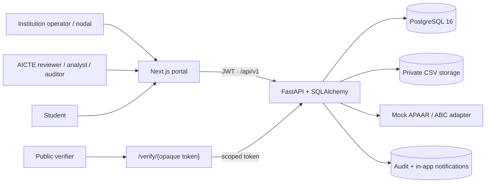
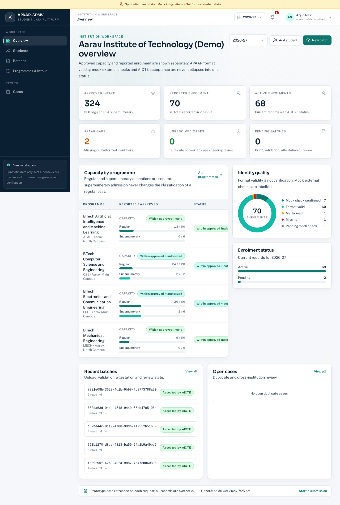
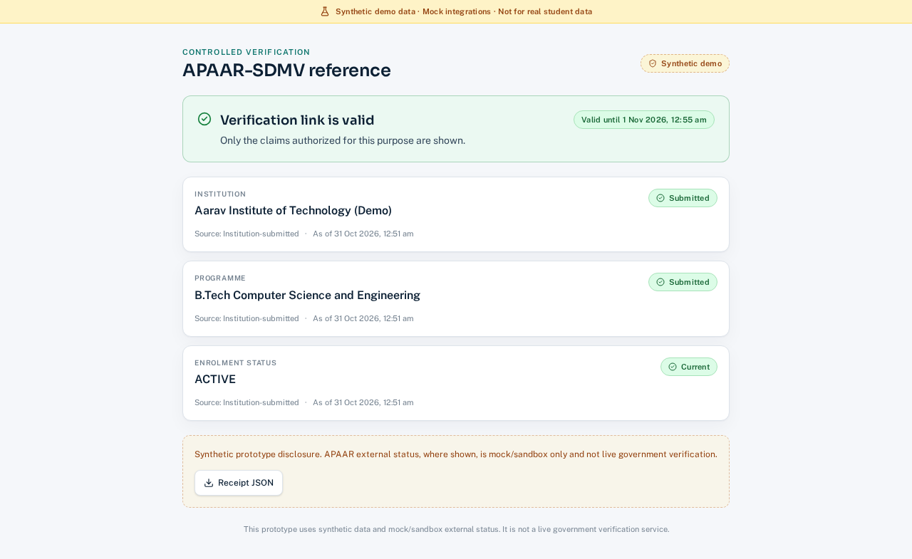

# APAAR-SDMV (prototype)

**APAAR Student Data Management & Verification Platform — a working, demo-ready prototype.**

This repository implements the lifecycle described in
[`APAAR_Student_Data_Platform_PRD.md`](./APAAR_Student_Data_Platform_PRD.md):
institution onboarding → approved intake → enrolment submission → explainable
validation → duplicate/capacity review → nodal attestation → AICTE review →
reporting and audit → student-controlled, purpose-bound verification.

> ⚠️ **Synthetic data only. Mock integrations only.**
> Every external check (APAAR/ABC/DigiLocker/NAD/AICTE) is a visibly labelled
> mock/sandbox adapter. This is not an AICTE production system, does not issue
> APAAR IDs, and must never be used with real student data. APAAR format
> validity, mock external status and AICTE acceptance are always shown as
> separate claims.

## What is implemented

| Area | Capability |
|---|---|
| Identity & access | Institution/AICTE/student/verifier roles, scoped memberships, Argon2 passwords, 30-minute JWTs, audit of sign-ins and privileged actions |
| Master data | Institutions, campuses, programmes, versioned intake snapshots with regular and supernumerary allocations kept separate |
| Ingestion | Strict CSV upload (`.csv`, media type, 5 MB, 10,000 rows, BOM/header/UTF-8 checks), SHA-256 evidence, row-level correction and resubmission |
| Validation | Rule IDs and evidence for APAAR format/missing values, mapping, dates, attributes, duplicates, cross-institution overlaps and capacity warnings |
| Workflow | Nodal attestation required, submission receipts, reviewer accept/return/reject with reason and full history |
| Review & analytics | National dashboard, review queue, institution drill-down, duplicate cases with human resolution, reports and audited CSV exports |
| Verification | Student consent requests, claim allow-listing, QR/copy links, expiring/revocable opaque tokens, signed receipts, generic denial |
| Ops | Append-only audit trail, in-app notifications (email is mock-only), rate limits, log redaction, accessibility notes and browser smoke tests |

## Architecture



### Screenshots





More flows and the full evidence log are in
[`docs/evidence/`](docs/evidence/README.md).

## Quickstart

```bash
# Postgres + API + web console. The API seeds synthetic demo data on first boot.
make demo            # or: docker compose up --build

# API health:   http://localhost:8000/api/v1/health
# Swagger:      http://localhost:8000/api/v1/docs
# Web console:  http://localhost:3000
```

After the stack is healthy, run the end-to-end API smoke test:

```bash
make smoke
```

Demo accounts all use password `Demo@1234`:

| Persona | Email |
|---|---|
| Institution admin | `admin@demo-ait.edu` |
| Institution operator | `operator@demo-ait.edu` |
| Nodal officer | `nodal@demo-ait.edu` |
| AICTE reviewer | `reviewer@aicte.demo` |
| AICTE supervisor | `supervisor@aicte.demo` |
| AICTE analyst | `analyst@aicte.demo` |
| Auditor | `auditor@aicte.demo` |
| System admin | `sysadmin@aicte.demo` |
| Student | `student@demo-ait.edu` |
| External verifier | `verifier@acme-demo.example` |

The seeded student is linked to the synthetic APAAR `123456789012`; the UI only
shows a masked form.

## Local development

```bash
# API (SQLite is fine for local work)
cd apps/api
uv sync
ENV=development DATABASE_URL=sqlite:///./var/local.db uv run uvicorn app.main:app --reload --port 8000

# Web
cd apps/web
npm ci
npm run dev
```

Run without Docker, or use `make seed` to reset the deterministic synthetic
dataset. The API auto-seeds only when `ENV=development` and `AUTO_SEED=true`.

## Verification commands

```bash
make test        # API (Ruff + pytest) and web (Vitest + typecheck + lint)
make e2e         # Playwright browser flows; writes docs/evidence screenshots
make benchmark   # 10,000-row upload + validation benchmark
make build       # production web build plus all checks
make smoke       # end-to-end API smoke against a running stack
```

Latest local evidence (2026-10-31): all API and web tests green, 4 Playwright
flows green, and 10,000 synthetic rows validated in ~12.3 seconds on SQLite
(13.3 seconds including upload; prototype benchmark, not a production SLA). See
[`docs/evidence/README.md`](./docs/evidence/README.md),
[`docs/acceptance.md`](./docs/acceptance.md) and
[`docs/limitations.md`](./docs/limitations.md).

## Repository layout

| Path | Purpose |
|---|---|
| `apps/api` | FastAPI service (Python 3.12, SQLAlchemy 2, Pydantic v2) |
| `apps/web` | Next.js 16 App Router console (React 19, Tailwind 4) |
| `scripts/` | Smoke, benchmark and verification helpers |
| `docs/` | Design, plans, API/data/security/privacy/deployment docs and evidence |
| `data/` | Synthetic demo CSVs and fixtures |
| `docs/superpowers/` | Design spec and 14-task implementation plan |

## Conventions and safety boundaries

- API base path `/api/v1`; responses are camelCase; errors use
  `{"error": {"code", "message", "details"}, "traceId"}`.
- APAAR identifiers are encrypted at rest (Fernet), keyed-HMAC searchable, and
  displayed only as last-4. They never appear in logs, URLs, analytics or
  exports, and are never used as authentication.
- Every institution-owned query is scoped server-side. Duplicate matches create
  review cases; the system never labels a student as fraudulent or cancels an
  enrolment automatically.
- Verification links are opaque, hashed at rest, expiring, revocable, and every
  attempt is audited. Unknown, expired and revoked tokens get the same generic
  `410` response.
- Analyst reports are aggregate-first with small-group suppression; CSV exports
  neutralize spreadsheet formula injection and are audited.
- Rate limits: login `10/min/IP`, public verification `30/min/IP`. The limiter is
  in-process for the prototype; production needs Redis/WAF.
- No production MFA/OIDC, KMS, database encryption at rest, WAF, SIEM, or
  migration tooling is implemented. See `docs/security.md` before any real use.
